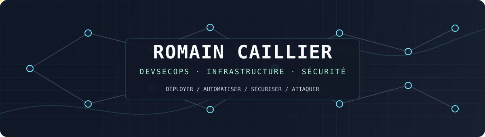
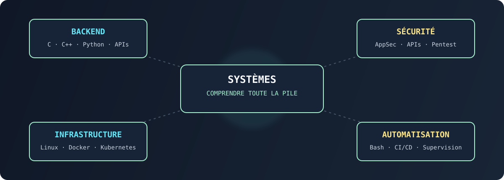
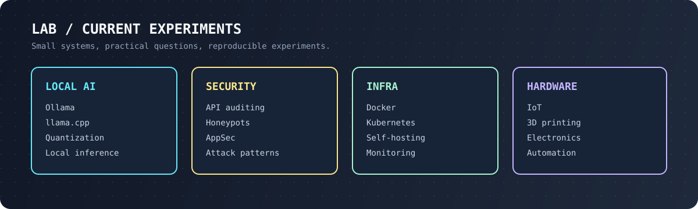

  
  
  

**🔎 Recherche d'alternance DevSecOps · dès juin 2027** 
RNCP 7 (Bac+5) Expert en architecture informatique · 12 mois · 3 semaines entreprise / 1 semaine école 
Bordeaux de préférence, mobile partout en France

## `whoami`

Étudiant à [42 Angoulême](https://42angouleme.fr/), je travaille là où **l'infrastructure, l'automatisation et la sécurité** se rejoignent.
Je fais tourner ma propre infra en production (VPS, homelab, Docker, reverse proxy, CI) et j'ai une expérience de **pentest d'infrastructure en entreprise**.

> Je déploie, j'automatise, je sécurise — et je teste comme un attaquant.

  

## Projets phares

Le code de certains projets est en cours d'assainissement avant publication : les études de cas détaillent l'architecture, les choix et les difficultés.

| Projet | En bref | Liens |
| --- | --- | --- |
| **Infra en production + honeypot SSH** | 7 stacks Docker Compose sur 2 hôtes. Le port 22 du VPS est un piège : **239 088 connexions** piégées depuis août 2026, bannissement fail2ban piloté depuis un dashboard sans privilège. | [Étude de cas](https://caillier-romain.fr/projets/infra.html) |
| **Territory Twin** | Jumeau numérique territorial (INSEE, BPE, RPPS) pour simuler la fermeture d'un service sur ~35 000 communes. ~1 100 tests automatisés. | [Étude de cas](https://caillier-romain.fr/projets/territory-twin.html) · [Démo](https://territoire.caillier-romain.fr/?territory=nouvelle-aquitaine) |
| **Lab de pentest IA isolé** | Évaluer des agents de pentest à LLM local sans exposer l'hôte : 4 couches d'isolation (systemd, nftables, proxy filtrant, Docker rootless), modèle de menace. | [Étude de cas](https://caillier-romain.fr/projets/lab-pentest-llm.html) |
| **Kubernetes et GitOps** | K3s sur VM Vagrant, puis K3d + Argo CD, jusqu'à un GitLab local dans le cluster. En binôme. | [Étude de cas](https://caillier-romain.fr/projets/kubernetes.html) · [Code](https://github.com/rom98759/Inception-of-Things) |
| **Inception** | Infra conteneurisée Nginx / WordPress / MariaDB (+ Redis, FTP, Adminer) via Docker Compose. | [Code](https://github.com/rom98759/inception) |
| **Veille technologique locale** | Flux RSS triés et résumés par un LLM local, rapport HTML autonome. Rien ne sort du poste. | [Code](https://github.com/rom98759/llm_veille_tech) |

Tous les projets : [caillier-romain.fr/projets](https://caillier-romain.fr/projets/)

## Lab

  

## Projets 42

42 m'a donné les bases : programmation système, Unix, réseau et travail en équipe.

| Projets | Notions |
| --- | --- |
| [Libft](https://github.com/rom98759/BIG_LIBFT) · [ft_printf](https://github.com/rom98759/ft_printf) · [get_next_line](https://github.com/rom98759/Get-Next-Line) | C, mémoire, descripteurs de fichiers |
| [Minitalk](https://github.com/rom98759/Minitalk) · [Philosophers](https://github.com/rom98759/Philosophers) | Processus, signaux, threads, synchronisation |
| [Minishell](https://github.com/rom98759/Minishell) · [cub3d](https://github.com/rom98759/cub3d) | Shell Unix, parsing, raycasting |
| [ft_irc](https://github.com/rom98759/ft_irc) · [Transcendence](https://github.com/rom98759/transcendence) | Réseau C++, microservices, temps réel |
| [Inception](https://github.com/rom98759/inception) · [Inception-of-Things](https://github.com/rom98759/Inception-of-Things) | Docker, Kubernetes, GitOps |

## Outils

  

## Parcours

| Étape | Ce que j'y ai fait |
| --- | --- |
| Lycée | Bac maths-informatique mention Bien, club de robotique, compétition CSAW Red Team |
| 42 Angoulême | C, Unix, réseau, C++, Docker, Kubernetes — titre RNCP 7 visé |
| 2026 | Stage de pentest d'infrastructure en entreprise |
| Juin 2027 | Alternance DevSecOps / cloud / infra — **c'est là que vous intervenez** |

## Contact

Le plus simple : la [section contact](https://caillier-romain.fr/#contact) du site (e-mail affiché au clic) ou un message sur [LinkedIn](https://www.linkedin.com/in/romain-caillier/).
