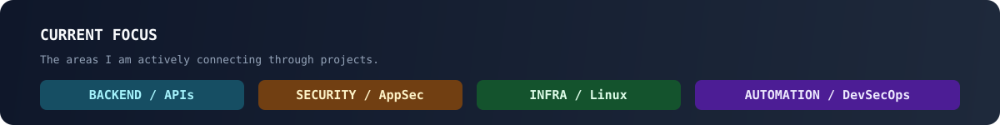
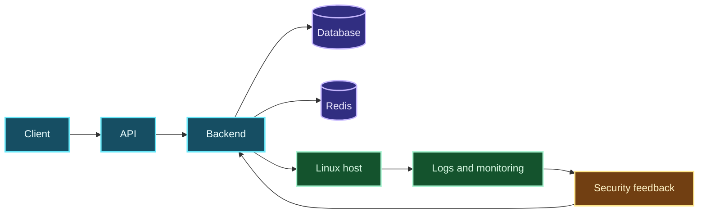
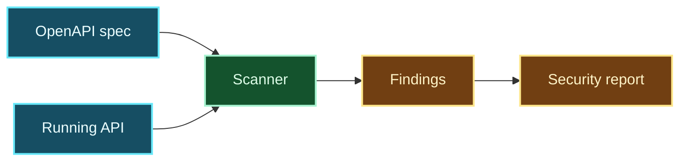
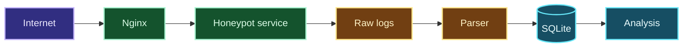

  
  
  

  

## `whoami`

I'm a software developer student at [42 Angoulême](https://42angouleme.fr/), interested in the point where **software engineering, infrastructure and security** meet.

I like understanding the whole system: the application, its APIs, the Linux host, the network and the controls that keep everything observable and resilient.

> Build it. Break it. Understand why. Automate the lesson.

<table>
<tr>
<td width="33%" valign="top">

### DEVELOPMENT

Systems programming, backend services and APIs.

`C` `C++` `Python` `TypeScript`

</td>
<td width="33%" valign="top">

### SECURITY

Application security, API auditing and attack analysis.

`AppSec` `OpenAPI` `Pentest` `Monitoring`

</td>
<td width="33%" valign="top">

### INFRASTRUCTURE

Linux systems, containers and reproducible deployments.

`Docker` `Kubernetes` `Nginx` `Cloudflare`

</td>
</tr>
</table>

## System map

This is how I connect the different parts of a project:

  

## Featured projects

The projects below are representative of the questions I like to explore. Each one starts with a system, a failure mode or an assumption worth testing.

### API audit scanner

> How different is the documented API from the application that actually runs?

An automation tool for comparing an OpenAPI surface with observed application behaviour and highlighting security-relevant gaps.

`OpenAPI` `REST` `Security` `Automation`

<b>Architecture</b>

### Honeypot and monitoring

> What does automated traffic reveal when a service is deliberately exposed?

A self-hosted environment for collecting, parsing and analysing suspicious activity around exposed services.

`Linux` `Docker` `Networking` `Python`

<b>Architecture</b>

### Self-hosted infrastructure

> How can personal services stay simple, observable and reasonably protected?

Linux infrastructure for containers, reverse proxying, HTTPS, DNS and security controls.

`Linux` `Docker` `Nginx` `Cloudflare`

### Local AI playground

> What changes when inference runs locally instead of behind an API?

Experiments with local inference, quantization, context size, memory usage and developer tooling.

`Ollama` `llama.cpp` `Open WebUI` `Linux`

## Lab

  

## 42 projects

42 has been my foundation for systems programming, Unix environments, networking and collaborative development.

| Project | Focus |
| --- | --- |
| [Libft](https://github.com/rom98759/Libft) · [ft_printf](https://github.com/rom98759/ft_printf) · [get_next_line](https://github.com/rom98759/Get-Next-Line) | C, memory, file descriptors |
| [Minitalk](https://github.com/rom98759/Minitalk) · [push_swap](https://github.com/rom98759/push_swap) | Processes, signals, algorithms |
| [Philosophers](https://github.com/rom98759/Philosophers) · [minishell](https://github.com/rom98759/minishell) | Threads, synchronisation, Unix |
| [cub3d](https://github.com/rom98759/cub3d) · [NetPractice](https://github.com/rom98759/netpractice) | Graphics, networking, TCP/IP |
| [ft_irc](https://github.com/rom98759/ft_irc) · [Inception](https://github.com/rom98759/inception) | C++, Docker, services |

## Technical landscape

  

## Journey

| Period | Direction |
| --- | --- |
| Robotics | Programming robots and competing with RoboCup Junior teams |
| 42 | C, Unix, systems programming, networking and C++ |
| Projects | Backend development, Linux, Docker and self-hosting |
| Today | Security automation, DevSecOps and local AI |

## Contact

I'm interested in backend development, security engineering and infrastructure projects where understanding the system matters.

- Website: [caillier-romain.fr](https://caillier-romain.fr)
- LinkedIn: [romain-caillier](https://www.linkedin.com/in/romain-caillier/)
- GitHub: [rom98759](https://github.com/rom98759)
- Email: [rcaillie@student.42angouleme.fr](mailto:rcaillie@student.42angouleme.fr)
