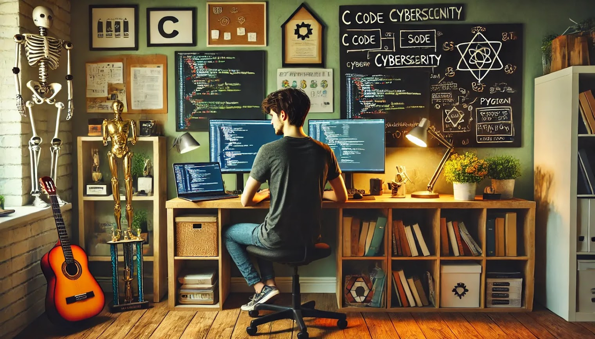

<h1 align="center">Hi 👋, I'm Romain</h1>
<h3 align="center">A passionate software development student at 42 Angoulême</h3>

	
	

  
  

## 📍 Languages and Tools:

    
	
	
	
    
    

## 42 School Projects

  
  
  
  
  

## 🏆 Achievements:
- Participated in the [CSAW Competition](https://www.csaw.io/), gaining valuable experience in cybersecurity and problem-solving.
- Member of the [RoboCup Junior](https://www.robocup.org/) team, where we program robots to compete in international robotics soccer competitions.

## 📍 Stay Connected:
- My portfolio : [Portfolio](https://rom98759.github.io/)
- Follow me on GitHub: [rom98759](https://github.com/rom98759)
- Email me: [rcaillie@student.42angouleme.fr](mailto:rcaillie@student.42angouleme.fr)

